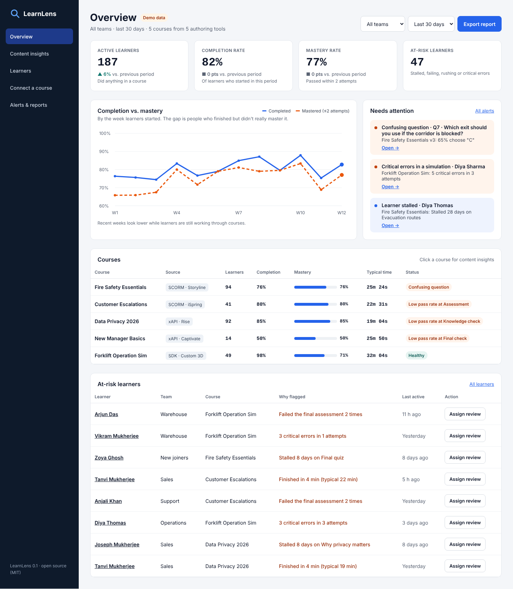
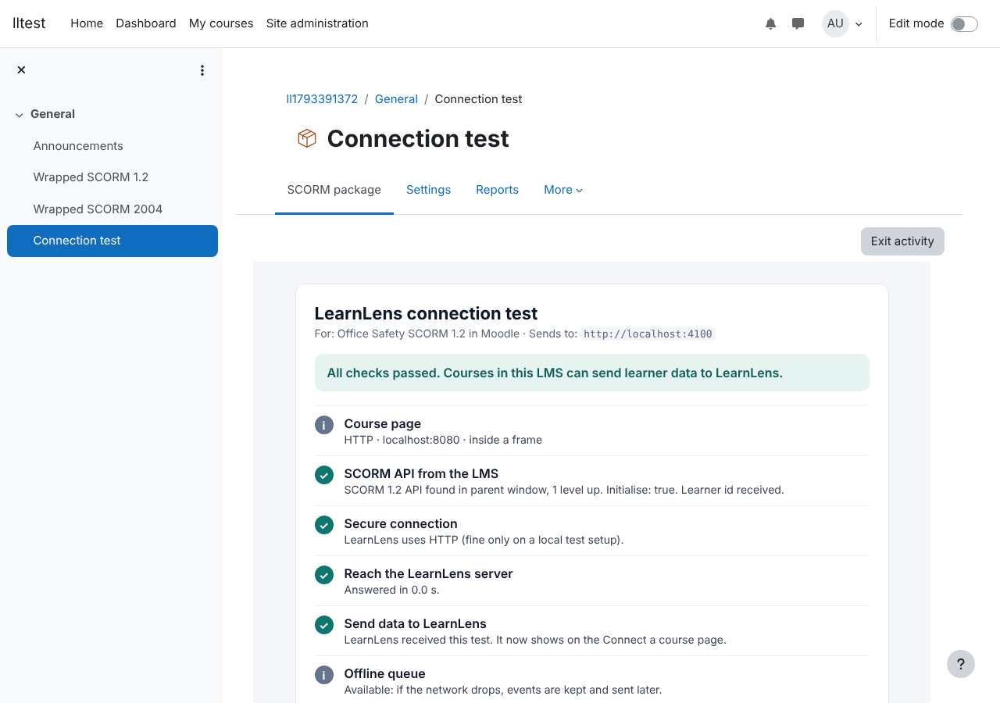
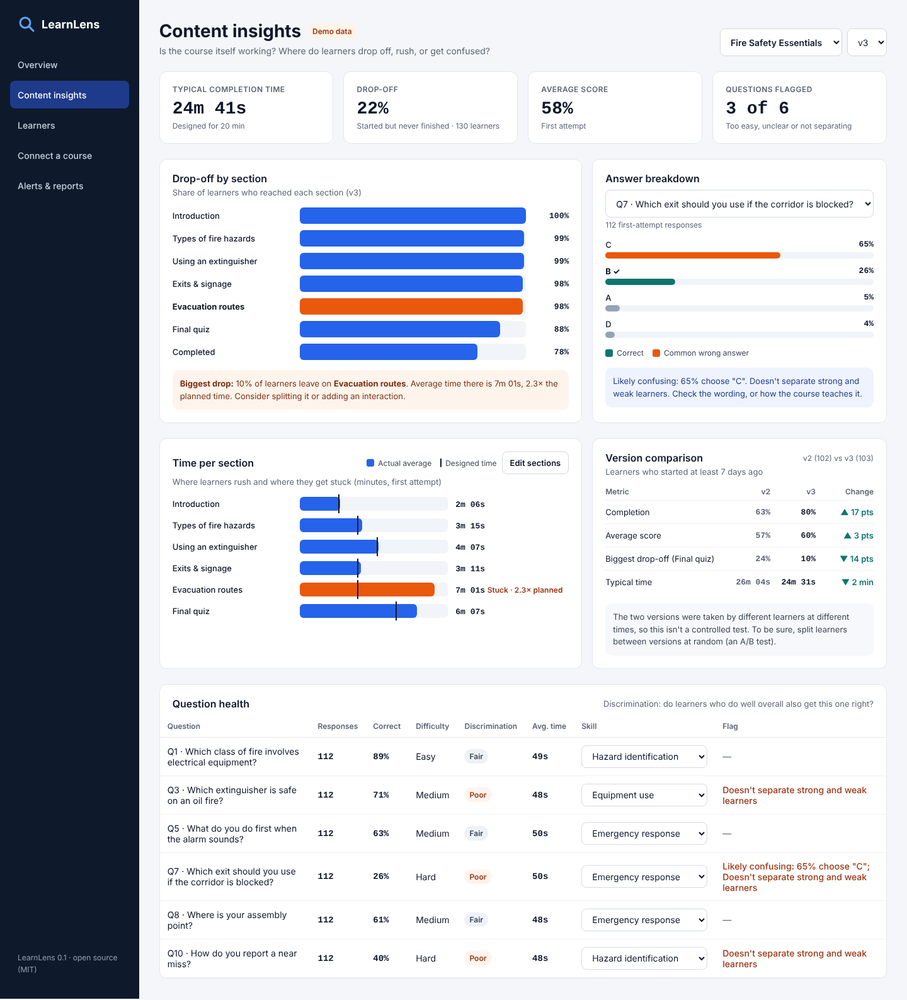
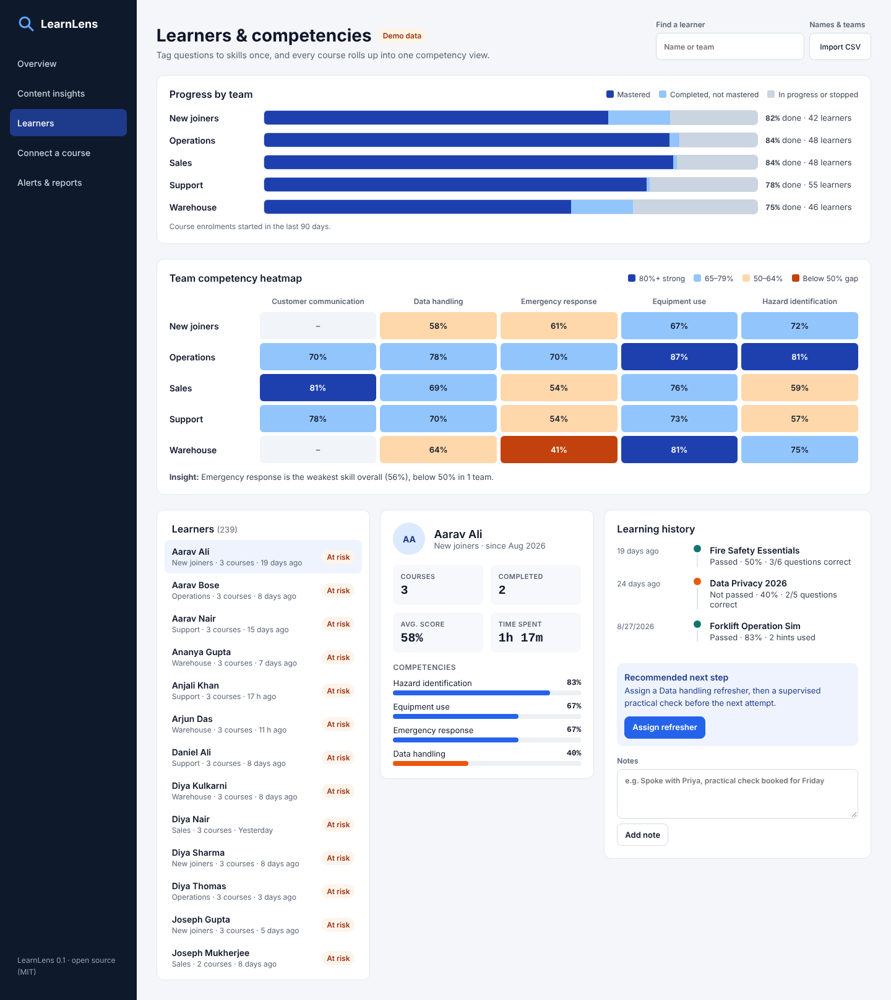
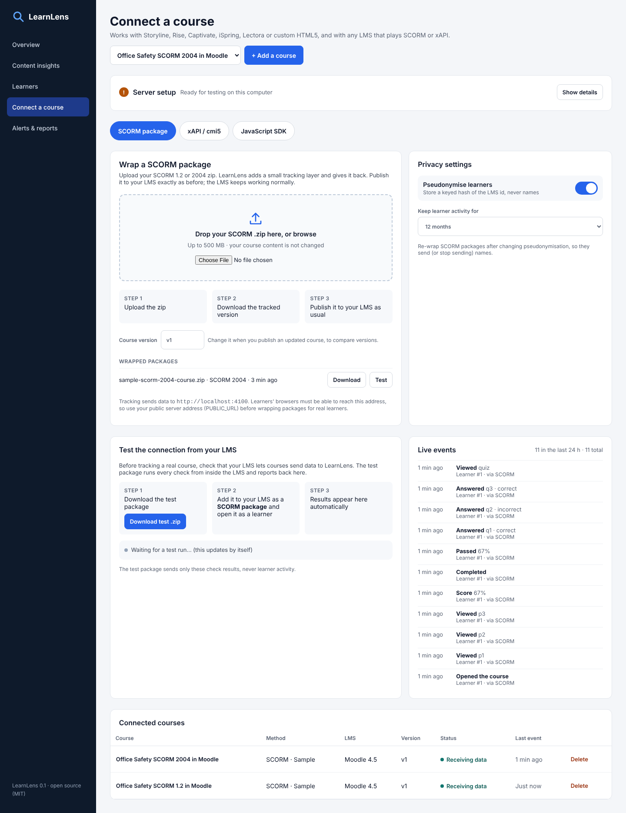
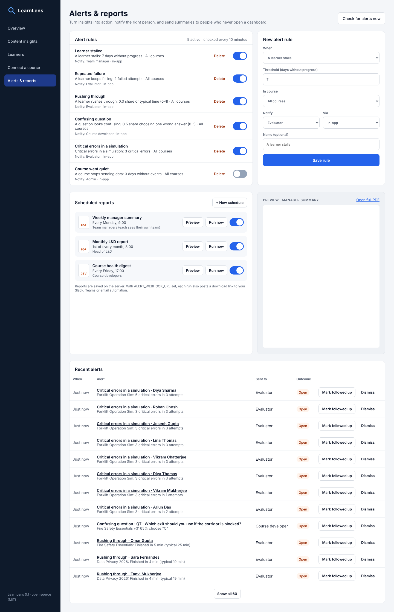
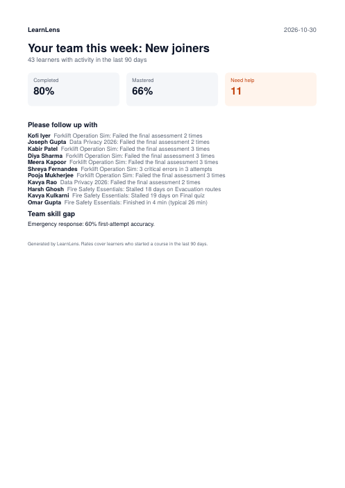

# LearnLens

**Open-source learning analytics for any eLearning course, in any LMS.**

Most LMSs only tell you who *completed* a course. LearnLens shows what actually happened inside it: where learners drop off, which questions confuse them, which skills a team is missing, and who needs help, without changing your LMS.



- **Works with what you already have.** Storyline, Rise, Captivate, iSpring, Lectora, custom HTML5 or 3D, in Moodle, TalentLMS, Docebo, Cornerstone, SAP SuccessFactors or any LMS that plays SCORM or xAPI.
- **Three ways in, one data model.** Wrap a SCORM package, send xAPI statements, or use the JavaScript SDK. Everything is normalised into one event model, so every report works the same for every course.
- **Two audiences.** Course developers see whether the *content* works. Evaluators and managers see whether *learners* are succeeding.
- **From insight to action.** Alert rules, follow-up notes, assigned refreshers, and scheduled PDF reports for managers who never open a dashboard.
- **Free and self-hosted.** MIT licence. Your learner data stays on your server.

> **Status: v0.1, a working MVP.** Tested end to end in **Moodle 4.5** with SCORM 1.2 and SCORM 2004 packages (see [What has been tested](#what-has-been-tested)). It is young: pilot one course first, and read [Limitations](#limitations).

**Put it online in a few clicks:** the button below creates your own copy of LearnLens on Render, with HTTPS and a database. The step-by-step guide is in **[docs/DEPLOY.md](docs/DEPLOY.md)**.

[](https://render.com/deploy?repo=https://github.com/ankitaalgorithm-LD/learnlens)

---

## Contents

- [Quick start (5 minutes)](#quick-start-5-minutes)
- [Track your own course](#track-your-own-course)
- [Put it online for real learners](#put-it-online-for-real-learners)
- [What the dashboards show](#what-the-dashboards-show)
- [Configuration](#configuration)
- [Privacy and security](#privacy-and-security)
- [How it works](#how-it-works)
- [What has been tested](#what-has-been-tested)
- [Limitations](#limitations)
- [Development](#development)

---

## Quick start (5 minutes)

You need **[Node.js 20 or newer](https://nodejs.org)**. No database to install: LearnLens runs an embedded PostgreSQL for you.

```bash
# 1. Install and build (from the project folder)
npm run setup

# 2. Start the server
npm start
```

Open **http://localhost:4000**.

**Want to explore with realistic data first?** In a second terminal:

```bash
npm run demo
```

This creates five demo courses and 240 **synthetic** bot learners, and sends their activity through the real tracking endpoints (SCORM, xAPI and SDK), exactly like live courses would. Some problems are planted on purpose (a slide where people quit, a confusing quiz question, a team skill gap) so you can see how LearnLens surfaces them.

> The demo turns off pseudonymisation so the fake names are visible. Turn it back on in **Connect a course → Privacy settings** before using real learner data, or start from a fresh install.

---

## Track your own course

In the dashboard, go to **Connect a course → + Add a course**, then pick the method that fits.

### First: test the connection from your LMS

Under **Test the connection from your LMS**, click **Download test .zip**, add it to your LMS as a SCORM package, and open it as a learner. From inside the LMS it checks everything tracking needs (the LMS's SCORM API, HTTPS, security policies, whether the server answers) and explains how to fix anything that fails. The results also appear in the dashboard, and **Live events** shows data arriving while you try your real course.



### Option 1: SCORM package (Storyline, Captivate, iSpring, Lectora…)

1. Export your course as **SCORM 1.2 or SCORM 2004** (a `.zip`).
2. Drop the zip on the **SCORM package** tab.
3. Click **Test it in your browser** to try it in LearnLens's built-in test LMS and see every SCORM call.
4. **Download the tracked package** and upload it to your LMS exactly as you normally would.

The wrapper adds one small script (`learnlens/learnlens-scorm.js`) and two lines to the course's launch page. Your content is untouched. The script sits between the course and the LMS: every SCORM call is passed straight through to the LMS unchanged, and LearnLens reads a copy of what the course reports (slides, answers, scores, completion). If LearnLens is unreachable, the course and the LMS keep working normally, and events are retried later.

Try it with the included sample courses: `examples/sample-scorm-course.zip` (SCORM 1.2) and `examples/sample-scorm-2004-course.zip` (SCORM 2004).

### Option 2: xAPI / cmi5 (Rise, Storyline, Captivate, LMS forwarding)

Use the endpoint, username and password from the **xAPI / cmi5** tab as the course's LRS, or add LearnLens as an extra LRS or forwarding target in your LMS/LRS. LearnLens reads `answered`, `experienced`, `completed`, `passed`, `failed` and similar verbs, and stores State API bookmarks so courses can resume.

Add the learner's team to `context.extensions` (any key ending in `/team`) to fill team reports automatically.

### Option 3: JavaScript SDK (custom HTML5, Three.js, Babylon.js, Unity WebGL, games)

```html
<script src="https://YOUR-LEARNLENS-SERVER/sdk/learnlens.js"></script>
<script>
  const track = LearnLens.init({
    endpoint: 'https://YOUR-LEARNLENS-SERVER',
    key: 'ck_…',                                   // from "Connect a course"
    learner: { id: 'lms-user-42', name: 'Priya Nair', team: 'Warehouse' }
  });

  track.page('loading', 'Loading the pallet');      // a slide, scene or section
  track.decision('pallet_hazard', { correct: false, critical: true });
  track.error('pallet_hazard', { critical: true });
  track.hint('load_balance');
  track.question('q1', { response: 'B', correct: true });
  track.complete({ passed: false, score: 0.67 });
</script>
```

A working example is in `examples/sdk-demo/index.html`. Inside an LMS, use the LMS's learner id (for SCORM, `cmi.core.student_id`).

### Names and teams

LMSs usually send a learner id but not a team. Upload a CSV with `id,name,team` (id = the learner id in your LMS) via **Learners → Import CSV** to group learners by team.

### Skills (competencies)

On **Content insights**, tag each question to a skill once. LearnLens then builds the team competency heatmap and each learner's skill profile across all courses.

---

## Put it online for real learners

Learners' browsers send tracking data straight to LearnLens, so **your LearnLens server must be reachable from wherever learners take the course, over HTTPS.** Almost every LMS runs on HTTPS, and browsers block an HTTPS course from sending data to a plain-HTTP server.

**[docs/DEPLOY.md](docs/DEPLOY.md)** walks through three ways, step by step:

| Option | Best for |
|---|---|
| **Render, one click** (`render.yaml` included) | Most people: no terminal, HTTPS and database set up for you |
| **Docker** (`docker-compose.yml` included) | IT teams and company servers |
| **A tunnel from your laptop** | A quick test with a real LMS |

Whichever you choose: set `PUBLIC_URL` to the HTTPS address *before* wrapping packages (on Render this is automatic), set `ADMIN_TOKEN` and `HASH_SECRET`, and check that the **Server setup** panel on *Connect a course* shows green ticks.

---

## What the dashboards show

| Screen | For | What you get |
|---|---|---|
| **Overview** | Managers, L&D leads | Active learners, completion vs. **mastery**, at-risk learners, course health, alerts, one-click PDF report |
| **Content insights** | Course developers | Drop-off funnel, time per section vs. designed time, answer breakdown per question, question health (difficulty and discrimination), version comparison, skill tagging |
| **Learners** | Evaluators, managers | Progress by team, team × skill heatmap, learner profiles with history, notes, assignments and a recommended next step |
| **Connect a course** | Admins | SCORM wrapping and test LMS, xAPI credentials, SDK snippet, course versions, privacy settings |
| **Alerts & reports** | Everyone | Alert rules, alert log with outcomes, scheduled PDF/CSV reports |

Every metric is defined in **[docs/METRICS.md](docs/METRICS.md)**: what it means, how it is calculated, and which decision it supports.

<details>
<summary>More screenshots</summary>







</details>

---

## Configuration

All settings are environment variables (see `.env.example`).

| Variable | Default | What it does |
|---|---|---|
| `ADMIN_TOKEN` | *(empty)* | Password for the dashboard and admin API. **Required on any shared server.** If empty, anyone who can reach the server can open the dashboard. |
| `PUBLIC_URL` | address you open it on | Public HTTPS address learners' browsers use. Written into wrapped packages and SDK snippets. |
| `HASH_SECRET` | a development value | Secret for pseudonymising learner ids. Set it once and never change it (changing it splits every learner into a new person). |
| `DATABASE_URL` | *(empty)* | PostgreSQL connection string. Empty = embedded PostgreSQL in `DATA_DIR`. |
| `DATA_DIR` | `./data` | Embedded database, wrapped packages and generated reports. |
| `PORT` | `4000` | HTTP port. |
| `ALERT_WEBHOOK_URL` | *(empty)* | Alerts and report links are POSTed here as JSON with a `text` field: works with Slack and Teams incoming webhooks, Zapier and Make (which can email people). |

---

## Privacy and security

- **Pseudonymisation is on by default.** LearnLens stores a keyed hash (HMAC-SHA-256 with `HASH_SECRET`) of the LMS learner id and no names. Names appear only if you turn pseudonymisation off or import a roster.
- **Data retention**: choose 6, 12 or 24 months (or keep forever). Older activity is deleted daily.
- **Course keys** only allow *sending* events for that one course. They cannot read anything. xAPI uses a separate per-course secret.
- **Admin API** is protected by `ADMIN_TOKEN` (constant-time comparison). Ingestion endpoints are rate-limited and validate every event.
- You are the data controller for your learners' data. Tell learners what is tracked, and check your organisation's policies (and laws such as GDPR or India's DPDP Act) before tracking real people.

---

## How it works

```
 Course in the learner's browser                    LearnLens server                     Dashboard
 ─────────────────────────────────                  ─────────────────                    ─────────
 SCORM course + wrapper script ── POST /api/ingest ─┐
 xAPI course / LMS            ── POST /xapi/statements ─► normalise ─► events table ─► analytics ─► React app
 Custom HTML5 / 3D + SDK      ── POST /api/ingest ─┘                     │                 alerts engine (every 10 min)
                                                                          └──────────────► PDF/CSV reports (scheduled)
```

**Common event model** (one row per event):

| Event | Meaning |
|---|---|
| `session_started` | Learner opened the course |
| `page_viewed` | Learner left a slide/section; `duration_ms` = time spent on it |
| `question_answered` | Assessment answer: `response`, `success` |
| `decision_made` | Scenario or simulation decision: `success`, `critical` |
| `hint_used` | Learner asked for help |
| `error_made` | Mistake in a simulation; `critical` for safety/quality-critical errors |
| `score_reported` | Score between 0 and 1 |
| `course_completed`, `course_passed`, `course_failed` | Outcomes |

**Project layout**

```
server/    Node.js + Express API, analytics, alerts, reports, SCORM wrapper
  src/scorm/learnlens-scorm.js   the script injected into SCORM packages
  scripts/simulate.js            bot learners for demo data
  test/                          automated tests
web/       React dashboard (Vite)
sdk/       learnlens.js, the JavaScript SDK
examples/  sample SCORM 1.2 and 2004 courses, SDK demo
docs/      deploy guide, metric definitions, screenshots
render.yaml, docker-compose.yml   one-click Render deploy and Docker setup
```

**Stack:** Node.js, Express, PostgreSQL (or embedded PGlite), React, Vite, PDFKit. No paid services.

---

## What has been tested

| Test | Result |
|---|---|
| Wrapped **SCORM 1.2** course in **Moodle 4.5** (PostgreSQL), opened and completed as a learner | Pages, answers, score and pass status all reached LearnLens; Moodle recorded the attempt normally |
| Wrapped **SCORM 2004** course in **Moodle 4.5** | Same as above, including completion and success status |
| Connection test package in Moodle 4.5 | All checks passed and results appeared in the dashboard |
| Connection test in an LMS page with a strict Content-Security-Policy | Correctly reported the block and the fix |
| xAPI statements and State API bookmarks | Accepted and analysed |
| JavaScript SDK from a page on a different site | Events arrived |
| Embedded database and external PostgreSQL | Both work |
| Fresh install from the zip, with a dashboard password | Works |
| Automated tests (`npm test`) | Ingestion, xAPI, SCORM wrapping, analytics, privacy, reports, connection check |

**Not yet tested:** other LMSs (TalentLMS, Docebo, Cornerstone, SuccessFactors, Canvas…), real Storyline/Rise/Captivate exports, Windows and macOS, the Docker image build and a live Render deploy. Run the connection test package in your LMS first; reports from other LMSs are very welcome.

## Limitations

Honest notes for v0.1:

- **One admin login.** Everyone with the admin token sees everything. Per-user accounts and "managers see only their team" are on the roadmap.
- **The xAPI endpoint is analytics-focused.** It accepts statements and bookmarks, but you can't query statements back out, so it doesn't replace a full LRS for compliance records.
- **Email** is delivered through a webhook (Slack, Teams, Zapier, Make), not built in.
- **Every LMS has quirks.** LearnLens is tested in Moodle; other LMSs launch courses in different ways. Run the connection test package and pilot one course in your own LMS first.
- **Files on hosts without a persistent disk** (such as Render web services) are cleared on restart: data in the database is safe, but wrapped packages and saved reports on the server are not. Download wrapped packages right after wrapping.
- **Comparisons are not experiments.** Version comparison and before/after numbers show *association*, not proof that a change caused an improvement. Use a random A/B split for that.
- **Demo data is synthetic.** Never present it as real learner results.

---

## Development

```bash
npm run setup          # install everything and build the dashboard
npm run dev:server     # API on :4000 with auto-reload
npm run dev:web        # dashboard on :5173 with hot reload (proxies to :4000)
npm test               # server tests (ingestion, xAPI, SCORM wrapper, analytics, privacy)
```

The admin API lives under `/api` (see `server/src/routes/admin.js`); tracking endpoints are `/api/ingest`, `/xapi/*` and `/sdk/learnlens.js`.

Contributions are welcome: bug reports from real LMSs and authoring tools are especially useful.

## License

[MIT](LICENSE): free to use, change and share, including commercially.
